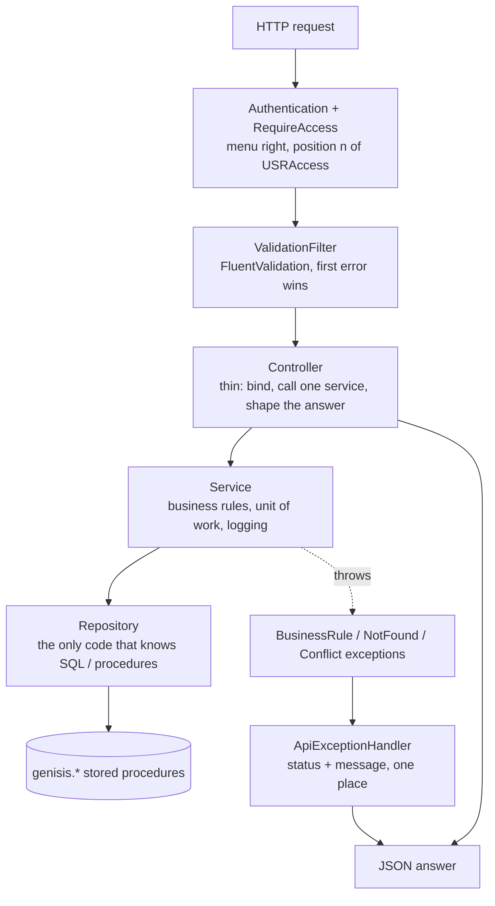
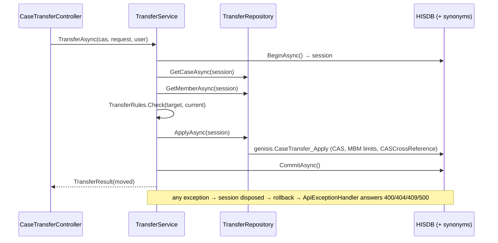

# Architecture, code organization, naming and reusable patterns

Applies to `Genisis` (ASP.NET Core 8 API) and `GenisisUI` (React 19 + Vite + TypeScript). Both talk to the same SQL Server
databases as the VB6 desktop application, so the desktop keeps working during the migration.

## 1. System context

```mermaid
flowchart LR
    user([User in a browser]) -->|HTTPS| ui[GenisisUI<br/>React + Vite build in wwwroot]
    ui -->|JSON + JWT| api[Genisis.Api<br/>ASP.NET Core 8]
    api --> main[(HISDB<br/>main)]
    api -. synonyms genisis.Maint_* .-> maint[(HISMaintenance)]
    api -. synonyms genisis.WS_* .-> ws[(HISWorkSheet)]
    api -. synonyms genisis.Pay_* .-> pay[(HISPayment)]
    api --> files[/ScannedDoc, ClaimASCI, CaseASCII<br/>server folders/]
    desktop([VB6 desktop app]) --> main
    desktop --> maint
    desktop --> ws
    desktop --> pay
```

- The API is stateless: identity travels in a JWT (`usr_access` carries the `USR.USRAccess` flags), nothing is kept in memory between requests.
- One connection (HISDB) per request. The other databases are reached through synonyms created by `sql/main/000_setup.sql`, so a save that touches
  several databases is **one transaction** (the desktop ran the same writes on up to four connections without one).
- The production UI is served by the API from `wwwroot` (single deployable); in development Vite proxies `/api` to the API.

## 2. Layers of the API



| Layer | Lives in | Knows about | Must not |
|---|---|---|---|
| Controller | `Controllers/<Screen>Controller.cs` | the service, request/response models, `[RequireAccess]` | touch Dapper / `SqlClient` / `DbConnections`, validate by hand, `try/catch` |
| Validator | `Case/<Screen>/…Validator` (FluentValidation `RequestValidator<T>`) | the request model only | read the database |
| Service | `Case/<Screen>/…Service` | repository **interfaces**, `IDbSessions`, domain rules, `ILogger` | reference a concrete repository or `HttpContext` |
| Repository | `Case/<Screen>/…Repository` (interface + implementation) | `IDbSession`, procedure names, Dapper | hold business rules or commit |
| Models | `Case/<Screen>/<Screen>.cs` | nothing | carry behaviour other than pure helpers |
| Cross-cutting | `Common/`, `Data/`, `Auth/` | everything above uses them | depend on a screen |

`tests/Genisis.Api.Tests/ArchitectureAndErrorHandlingTests.cs` enforces the table for the nine Case screens and the four Worksheet screens converted so far: controllers contain no data
access and no `try/catch`, depend on services only, services depend on abstractions, every repository sits behind a registered interface, every request
model has a validator.

### Unit of work

`IDbSessions.OpenAsync()` gives a read-only session, `BeginAsync()` a transaction. A service decides where the unit of work starts and ends; repositories
receive the `IDbSession` and never commit. Disposing a session that was not committed rolls it back, so an exception can never leave half a save behind.
Every service also exposes an overload that takes the caller's session, which is how the database tests run a real save and roll it back, and how a
future screen can compose two services in one transaction.



### Where the SQL lives

`sql/main/NNN_<screen>.sql` — one file per screen, `CREATE OR ALTER PROCEDURE genisis.<Screen>_<Action>`; `sql/genisis-main.sql` is generated from them
(a test fails when it is stale). HISDB runs at compatibility level 100, so the scripts avoid `TRY_CONVERT`, `FORMAT`, `IIF`, `CONCAT`, `EOMONTH`.
Legacy procedures that append a raw `@strAppend` string into dynamic SQL are never called; they are reproduced as parameterised procedures.

## 3. Code organization

```
Genisis/
  src/Genisis.Api/
    Auth/            login, JWT, USRAccess positions (AccessRight.cs), RequireAccess
    Common/          ApiExceptions, ApiExceptionHandler, RequestValidation (RequestValidator<T>, ValidationFilter), ApiControllerBase
    Data/            DbConnections, DbSessions (IDbSession), StoredProcedures (Dapper helpers), RowMapper, SqlText
    Case/<Screen>/   Models + Validators + Repository + Service of one screen   (the nine screens added in the last phase)
    Worksheet/<Screen>/   the same layout for Tracking, SendToAccounts, SendToAr, Enquiry and Lookups, with WorksheetCommon.cs (shared exception, row cap, search result)
    Case/*.cs        Registration / Adjustment / Enquiry / Tracking services written before the layered style (see section 6)
    Plans/ Registration/ Benefits/   maintenance and membership modules (earlier style)
    Controllers/     one controller per file
    Program.cs       composition root: Serilog, auth, validators, exception handler, AddCaseScreens()
  sql/               main/ and maintenance/ scripts + generated combined scripts + README
  tests/Genisis.Api.Tests/   unit, service (fake repositories), integration (WebApplicationFactory), architecture, database tests
GenisisUI/
  src/api/           axios client (token, 401 handling)
  src/auth/          session context, access positions (mirror of AccessRight.cs)
  src/components/    reusable UI: Button, Field, DataGrid, Tabs, Modal, Screen (PageShell/ActionBar/Stat), DateInput, notify
  src/lib/           pure helpers: masks, validation (Yup rules), exportCsv, format, notifyStore   (unit-tested)
  src/pages/<module>/  one folder per menu module (case, maintenance, membership); a screen = page + its local helpers
  e2e/               headless-Chrome suites against a running API
```

Adding a screen: model + validator + repository (interface and class) + service in `Case/<Screen>/`, register them in `AddCaseScreens()`, add the controller,
the `sql/main` file, the access position in `AccessRight.cs` **and** `access.ts`, then the page and route in the UI.

## 4. Naming conventions

Enforced by `.editorconfig` (naming rules, file-scoped namespaces, using placement) and CI.

| Thing | Convention | Example |
|---|---|---|
| Classes, records, methods, properties, public constants | PascalCase | `TransferService.TransferAsync` |
| Interfaces | `I` + PascalCase | `ITransferRepository` |
| Locals, parameters | camelCase | `userCode` |
| Private fields | `_camelCase` | `_maintenanceDbName` |
| Async methods | `…Async` | `GetCaseAsync` |
| Controller | `<Screen>Controller`, route `api/<module>/<screen>` | `CaseTransferController` → `api/case/transfer` |
| Service / repository / validator | `<Screen>Service`, `<Screen>Repository`, `<Request>Validator` | `PayClaimRequestValidator` |
| Procedures | `genisis.<Screen>_<Action>` | `genisis.CaseTransfer_Apply` |
| Synonyms | `genisis.Maint_*`, `genisis.WS_*`, `genisis.Pay_*` (the database they point to) | `genisis.WS_Claim` |
| Tests | `<Behaviour_in_words>` methods in `<Area>Tests` | `Transfer_refuses_a_target_that_breaks_the_rules_and_changes_nothing` |
| React components / hooks | PascalCase file = component; `use…` for hooks | `CaseTransferPage.tsx`, `useScreenLookups.ts` |
| TS helpers / tests | camelCase file; `*.test.ts` next to the code | `listingRules.ts`, `listingRules.test.ts` |
| Messages | the desktop's wording when one exists | `Please Enter Discount Type!` |

Public API members of the layered code carry XML documentation; the compiler enforces it there (`CS1591` is an error in those folders) and the XML file
feeds Swagger.

## 5. Reusable component patterns (UI)

| Need | Use | Notes |
|---|---|---|
| Any button | `components/Button` | variants `primary` / `ghost` / `link`; `busy` + `busyLabel` disable it and announce `aria-busy`; defaults to `type="button"` |
| Form field | `components/Field` (`TextField`, `NumberField`, `TimeField`, `DateField`, `SelectField`, `ComboField`, `CheckField`, `ReadField`, `TextAreaField`) | label + control + accessible error (`aria-invalid`, `aria-describedby`); wired to React Hook Form |
| Validation | React Hook Form + Yup rules from `lib/validation.ts` (`requiredText`, `dmyDate`, `hhmmTime`, `amount`) | messages are the desktop's |
| Table | `components/DataGrid` | sortable (`aria-sort`), selectable/checkable, empty state that keeps headers |
| Tabs | `components/Tabs` | ARIA tabs with arrow / Home / End keys |
| Confirm / notice | `ask()` and `notify()` from `lib/notifyStore` | replaces `MsgBox`; confirm dialog is a focus-trapped modal |
| Page chrome | `PageShell`, `ActionBar`, `Stat` from `components/Screen` | title, command bar, counters |
| Dropdown data | `pages/case/useScreenLookups` | one hook, only the lists a screen asks for |
| Dates | `DateInput` | `dd/mm/yyyy` mask with a calendar picker; API receives ISO dates |
| Styling | classes and CSS variables in `index.css`; **no inline styles** | |
| Pure rules | a `…Rules.ts` file next to the page | unit-tested without a browser (`listingRules.ts`) |

A typical screen:

```tsx
const { handleSubmit, formState } = useForm({ resolver: yupResolver(schema) })
const load = handleSubmit(async ({ caseNo }) => {
  try { setView((await api.get<View>(`/api/case/transfer/${caseNo}`)).data) }
  catch (e) { notify(errorMessage(e), 'error') }        // the API's { message } is shown as is
})
…
<ActionBar>
  <Button variant="primary" type="submit" busy={busy} busyLabel="Loading…">Load</Button>
  <Button variant="link" onClick={() => navigate('/')}>Close</Button>
</ActionBar>
```

## 6. SOLID / Clean Architecture — where this stands

- **Single responsibility** — controllers orchestrate, validators validate, services hold rules, repositories hold SQL, `ApiExceptionHandler` maps errors.
- **Open/closed** — a new screen adds files and one registration line; nothing existing changes.
- **Liskov / interface segregation** — small per-screen repository interfaces; fakes in the tests implement them without extra members.
- **Dependency inversion** — services depend on `I…Repository`, `IDbSessions`, `IScannedDocuments`, `IAsciiFileStore`; concrete classes are chosen in the composition root.
- **Clean Architecture** — the layering above is real but expressed with folders, namespaces and architecture tests inside **one** API project. It is not (yet)
  split into Domain / Application / Infrastructure assemblies, and only the nine Case screens and the Worksheet screens added since follow it completely. Registration, Plans,
  Benefits, Case Registration / Adjustment / Enquiry / Tracking and Membership still use services that call Dapper directly, static validators and
  module-specific exceptions (these now derive from `BusinessRuleException`, so the central handler already covers them). See
  [scalability-recommendations.md](scalability-recommendations.md) for the path to finish the conversion.
